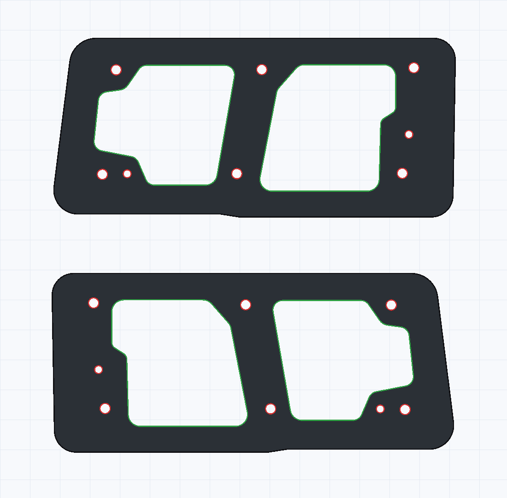

# 1993 Mazda 323 BG 3-Door Hatchback — Tail Light Seal DXF Templates

Parametric 1:1 millimeter DXF cutting models and SVG blueprint for the rear combination lamp housing gaskets, modeled to Mazda OEM catalog diagram `51-164`:
- **`B467-51-168`** (`B46751168`): Left-Hand (LH / Driver Side)
- **`B467-51-158`** (`B46751158`): Right-Hand (RH / Passenger Side)

> **Important Fitment Note:** Mazda never published standalone dimensional engineering drawings for `B467-51-168` / `B467-51-158` (they were die-cut closed-cell foam gaskets supplied with the `B467-51-161` / `B467-51-151` lamp housings). These DXF files match the OEM `51-164` 2-aperture stepped-boss silhouette (outer profile `350 mm × 165 mm` with `9 mm` downward alignment tab, two asymmetric stepped inner cutouts, and 6 mounting/locator holes). **Print `preview_blueprint.svg` at 100% scale on paper, verify the `100.0 mm × 20.0 mm` calibration coupon, and test-fit against your physical lamp housing before cutting foam.**

## Preview



For 1:1 scale paper printing and dimension callouts, see [preview_blueprint.svg](preview_blueprint.svg).

## Geometry Highlights

- **Outer Contour (`CUT_OUTER`):** `350.0 mm × 165.0 mm` main body with rounded corners and the integral `44.0 mm × 9.0 mm` downward-protruding bottom alignment tab (`y = -9.0 mm`) below the outer chamber.
- **Two Asymmetric Stepped Inner Cutouts (`CUT_INNER`):**
  - **Left / Outer Cutout:** Stepped inward at the bottom-left and top-right bridge corner bosses.
  - **Right / Inner Cutout:** Stepped inward at both upper-right and lower-right L-bosses, separated from the left cutout by the central bridge rib.
- **Six Mounting Stud / Locator Holes (`CUT_HOLES`, `Ø6.5 mm`):** `H1_top_outer`, `H2_bottom_outer_stud`, `H3_top_bridge`, `H4_bottom_bridge_stud`, `H5_top_inner_boss`, and `H6_bottom_inner_stud`.

## Generated Files

| File | Description |
| --- | --- |
| `B467-51-168_LH_tail_light_seal.dxf` | Left-Hand (LH) 2-aperture stepped-boss OEM gasket (AutoCAD R12 `AC1009`, mm) |
| `B467-51-158_RH_tail_light_seal.dxf` | Right-Hand (RH) 2-aperture stepped-boss OEM gasket (exact mirror of LH) |
| `B467-51-168_158_pair_nested.dxf` | LH + RH pair nested on a `380 mm × 400 mm` sheet with `100 mm` calibration bar |
| `B467-51-168_158_perimeter_variant.dxf` | LH + RH single-aperture perimeter ring variant (without central bridge rib) |
| `preview_blueprint.svg` | 1:1 printable visual blueprint with hole callouts, coordinate table, and `100 mm` scale bar |
| `params.json` | Editable millimeter polygon corners, fillet radii, and hole coordinates |
| `generate_seal_dxf.py` | Pure-Python generator script (standard library only) |
| `validate_dxf.py` | Structural and geometric DXF validator |

## DXF Layer Structure

| Layer | ACI Color | Contents |
| --- | --- | --- |
| `CUT_OUTER` | `7` (White) | Outer gasket perimeter incl. bottom alignment tab (closed `POLYLINE`, `flag 70 = 1`) |
| `CUT_INNER` | `3` (Green) | Stepped inner chamber cutouts (closed `POLYLINE`, `flag 70 = 1`) |
| `CUT_HOLES` | `1` (Red) | 6× mounting stud / locator holes (`Ø6.5 mm` `CIRCLE`) |
| `CALIBRATION` | `5` (Blue) | `100.0 mm × 20.0 mm` scale verification rectangle (nested sheets) |
| `ANNOTATIONS` | `8` (Gray) | Part numbers, crosshairs, sheet border, and material notes |

## Recommended Material & Thickness

- **Material:** **Closed-cell EPDM sponge / cellular rubber** (*Zellkautschuk* / *cauciuc spongios EPDM cu celule închise*). Closed-cell EPDM is UV-, ozone-, and weather-resistant (`-40 °C` to `+100 °C`) and does not absorb water. **Avoid open-cell foam**, which wicks water into the trunk/spare-tire well.
- **Thickness:** **`4 mm` (recommended)** — **`3 mm – 5 mm` acceptable**.
  - `4 mm`–`5 mm` compresses cleanly against the sheet-metal body lip without over-stressing the tail-light housing studs.
  - `3 mm` works well if the body flange is flat and undistorted.
- **Adhesive Backing:** Plain (no adhesive) or **single-sided self-adhesive** (applied to the plastic lamp housing side so the gasket remains removable from the painted body).
- **Minimum Sheet Size:** At least **`380 mm × 400 mm`** (e.g., `500 × 500 mm` or `500 × 1000 mm`) to cut both LH and RH seals from `B467-51-168_158_pair_nested.dxf`, or **`360 mm × 180 mm`** per single seal.

### EU Purchase Links (Verified)

| Supplier | Product | Thickness | Backing |
| --- | --- | --- | --- |
| [Diconfa (DE / EU)](https://diconfa.de/en/epdm-cellular-rubber-foam-sheet-in-various-sizes/) | EPDM Cellular Rubber Foam Sheet (custom sizes) | `1–50 mm` (select `4 mm` or `5 mm`) | Plain or self-adhesive |
| [VRTrade (NL / EU)](https://vrtrade.com/foam-rubber-sheet-epdm-4mm-width-100cm.html) | EPDM Sponge Rubber Sheet `4 mm` (`100 cm` width) | `4 mm` | Plain |
| [Fugendichtband24 (DE / EU)](https://www.fugendichtband24.de/EPDM-Zellkautschuk-Matten-4mm-Staerke-einseitig-selbstklebend-diverse-Abmessungen.htm) | EPDM Zellkautschuk Matten `4 mm` | `4 mm` | Single-sided self-adhesive |
| [Gummiprofile24 (DE / EU)](https://www.gummiprofile24.de/epdm_zellkautschuk-platte_5mm) | EPDM Zellkautschuk Platte / Matte `5 mm` | `5 mm` | Plain |

### Romanian Purchase Links (Verified)

| Supplier | Product | Thickness | Backing |
| --- | --- | --- | --- |
| [eMAG.ro](https://www.emag.ro/cauciuc-spongios-pentru-garnituri-epdm-placa-50x100-cm-grosime-5-mm-rub-002/pd/D32NQG3BM/) | Cauciuc spongios pentru garnituri EPDM, placă `50 × 100 cm` | `5 mm` | Plain |
| [CovoareCauciuc.ro](https://www.covoarecauciuc.ro/placi-din-cauciuc-spongios/placa-cauciuc-epdm-spongios-autoadeziv-grosime-3mm-latime-1000mm.html) | Placă cauciuc EPDM spongios autoadeziv (`1000 mm` lățime) | `3 mm` | Single-sided self-adhesive |
| [Poliuretan-Cauciuc.ro](https://www.poliuretan-cauciuc.ro/categorie-produs/cauciuc-celular-epdm-buretos/) | Cauciuc celular EPDM buretos (plăci / role) | Various (`3–5 mm+`) | Plain / self-adhesive |

## Customizing & Regenerating

Edit any vertex `{x, y, r}` or hole coordinate (`H1`–`H6`) in `params.json`, then regenerate and validate:

```bash
python3 generate_seal_dxf.py
python3 validate_dxf.py
```
