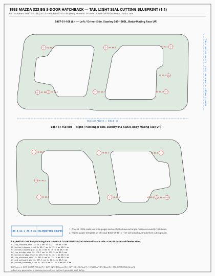

# 1993 Mazda 323 BG 3-Door Hatchback — Tail Light Seal DXF Templates

Parametric 1:1 millimeter DXF cutting models and SVG blueprint for the rear combination lamp housing gaskets, modeled to Mazda OEM catalog diagram `51-164`:
- **`B467-51-168`** (`B46751168`): Left-Hand (LH / Driver Side)
- **`B467-51-158`** (`B46751158`): Right-Hand (RH / Passenger Side)

> **Important Fitment Note:** Mazda never published standalone dimensional engineering drawings for `B467-51-168` / `B467-51-158` (they were die-cut closed-cell foam gaskets supplied with the `B467-51-161` / `B467-51-151` lamp housings). These DXF files match the OEM `51-164` 2-aperture stepped-boss silhouette (outer profile `350 mm × 165 mm` with `9 mm` downward alignment tab, two asymmetric stepped inner cutouts, and 6 mounting/locator holes). **Print `preview_blueprint.svg` at 100% scale on paper, verify the `100.0 mm × 20.0 mm` calibration coupon, and test-fit against your physical lamp housing before cutting foam.**

## Preview



## Geometry Highlights

- **Outer Contour (`CUT_OUTER`):** `350.0 mm × 165.0 mm` main body with rounded corners and the integral `44.0 mm × 9.0 mm` downward-protruding bottom alignment tab (`y = -9.0 mm`) below the outer chamber.
- **Two Asymmetric Stepped Inner Cutouts (`CUT_INNER`):**
  - **Left / Outer Cutout:** Stepped inward at the bottom-left and top-right bridge corner bosses.
  - **Right / Inner Cutout:** Stepped inward at both upper-right and lower-right L-bosses, separated from the left cutout by the central bridge rib.
- **Six Mounting Stud / Locator Holes (`CUT_HOLES`, `Ø6.5 mm`):** `H1_top_outer`, `H2_bottom_outer_stud`, `H3_top_bridge`, `H4_bottom_bridge_stud`, `H5_top_inner_boss`, and `H6_bottom_inner_stud`.

## Generated Files

| File | Description |
| --- | --- |
| `B467-51-168_LH_tail_light_seal.dxf` | Left-Hand (LH) 2-aperture stepped-boss OEM gasket (AutoCAD R12 `AC1009`, mm) |
| `B467-51-158_RH_tail_light_seal.dxf` | Right-Hand (RH) 2-aperture stepped-boss OEM gasket (exact mirror of LH) |
| `B467-51-168_158_pair_nested.dxf` | LH + RH pair nested on a `380 mm × 400 mm` sheet with `100 mm` calibration bar |
| `B467-51-168_158_perimeter_variant.dxf` | LH + RH single-aperture perimeter ring variant (without central bridge rib) |
| `preview_blueprint.svg` | 1:1 printable visual blueprint with hole callouts, coordinate table, and `100 mm` scale bar |
| `params.json` | Editable millimeter polygon corners, fillet radii, and hole coordinates |
| `generate_seal_dxf.py` | Pure-Python generator script (standard library only) |
| `validate_dxf.py` | Structural and geometric DXF validator |

## DXF Layer Structure

| Layer | ACI Color | Contents |
| --- | --- | --- |
| `CUT_OUTER` | `7` (White) | Outer gasket perimeter incl. bottom alignment tab (closed `POLYLINE`, `flag 70 = 1`) |
| `CUT_INNER` | `3` (Green) | Stepped inner chamber cutouts (closed `POLYLINE`, `flag 70 = 1`) |
| `CUT_HOLES` | `1` (Red) | 6× mounting stud / locator holes (`Ø6.5 mm` `CIRCLE`) |
| `CALIBRATION` | `5` (Blue) | `100.0 mm × 20.0 mm` scale verification rectangle (nested sheets) |
| `ANNOTATIONS` | `8` (Gray) | Part numbers, crosshairs, sheet border, and material notes |

## Material Recommendation

- **3 mm – 5 mm closed-cell EPDM sponge foam rubber** (single-sided pressure-sensitive adhesive backing optional on the housing side). Avoid open-cell foam, which absorbs water and causes trunk leaks.

## Customizing & Regenerating

Edit any vertex `{x, y, r}` or hole coordinate (`H1`–`H6`) in `params.json`, then regenerate and validate:

```bash
python3 generate_seal_dxf.py
python3 validate_dxf.py
```
